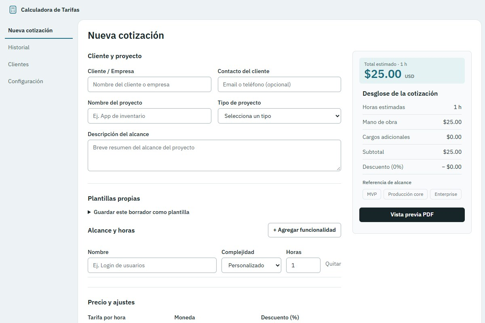
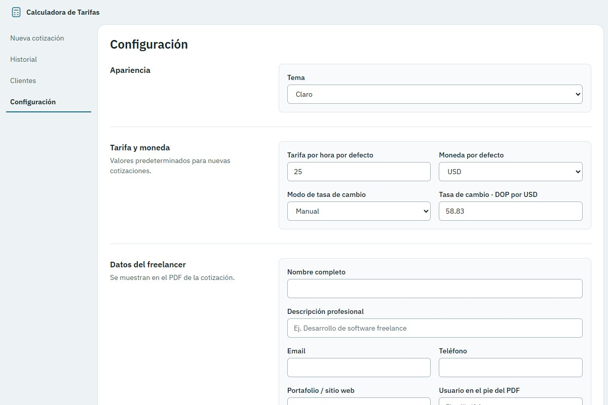

# 🧮 Cotizo

App de escritorio para cotizar proyectos de desarrollo de software
freelance en minutos: llenas un formulario, ves el total calculándose en
vivo, revisas la vista previa y guardas un PDF profesional listo para
enviarle al cliente. Es una herramienta **personal, de un solo usuario**
(sin cuentas, sin nube) — todo corre y se guarda localmente en tu máquina.

Construida con [Tauri](https://tauri.app), React y TypeScript. El plan
funcional original está en [`docs/PRD.md`](docs/PRD.md); este README
cubre qué tiene la app hoy y cómo usarla/desarrollarla.

## Inicio rápido en Windows

1. Descarga el instalador desde [Releases](https://github.com/wilrd14/Calculadora-Tarifas/releases) ejecuta el archivo `.exe` o `.msi` disponible y abre **Cotizo** desde el menú Inicio.
2. En **Configuración**, guarda tu tarifa por hora, la moneda habitual y la tasa USD/DOP. Puedes añadir tus datos profesionales para que aparezcan en el PDF.
3. Abre **Nueva cotización**, indica el cliente y el proyecto, y ajusta las funcionalidades, horas y condiciones. El total se actualiza mientras editas.
4. Pulsa **Vista previa PDF**, revisa el documento y guárdalo. Puedes abrirlo desde **Historial** o en `Documentos/Cotizaciones`.
5. Para seguir editando más tarde, abre **Historial → Borradores**. Para actualizar una cotización emitida, usa **Crear revisión** desde el registro original.

## Capturas





## ✨ Funciones

### Cotizar
- **Cliente y proyecto**: nombre del cliente/empresa, contacto, nombre y
  tipo de proyecto (Web, Web App, App Móvil, Escritorio, Web + Escritorio,
  SaaS, E-commerce, CRM, API/Integración, Automatización, IA, Otro),
  descripción del alcance.
- **Plantillas automáticas**: al elegir el tipo de proyecto, la lista de
  funcionalidades se rellena sola con ítems y horas típicas de ese tipo de
  trabajo (editable después, no es obligatorio usarla).
- **Ítems dinámicos**: agrega o quita funcionalidades/módulos con horas
  estimadas, o elige un nivel de complejidad (Baja/Media/Alta) que sugiere
  las horas por ti.
- **Multiplicadores de complejidad**: recargos porcentuales opcionales
  sobre la mano de obra — infraestructura cloud/Kubernetes (+15%),
  seguridad y cumplimiento (+20%), CI/CD (+10%), entrega urgente (+25%),
  IA/ML (+15%). Se ven reflejados en la vista previa y en el PDF, con el
  detalle de qué los compone.
- **Cargos adicionales**: línea(s) de monto fijo para cosas como diseño UI,
  despliegue, mantenimiento, etc.
- **Descuento** opcional en porcentaje.
- **Anticipo y cuotas mensuales**: define un anticipo (% del total, al
  aceptar) y reparte el resto en hasta 12 cuotas mensuales iguales. El
  calendario de pagos se ve en la vista previa y en el PDF; la última cuota
  absorbe el redondeo para que siempre sume el total exacto.
- **Métodos de pago y datos de transferencia**: se rellenan desde
  Configuración (con una cuenta por moneda, USD y DOP) y se pueden ajustar
  en cada cotización. Al cambiar de moneda se cambia la cuenta.
- **Niveles de alcance** de referencia (MVP, Producción core, Enterprise)
  que comparan tus horas totales contra rangos típicos, sin restringir
  nada — solo para orientarte.
- **Vista previa en vivo**: desglose completo (horas, subtotal de mano de
  obra, complejidad, cargos, descuento) y el total destacado, actualizado
  mientras escribes.

### Plantillas propias

En **Nueva cotización → Plantillas propias**, guarda el borrador con un
nombre para reutilizar su tipo de proyecto, módulos y horas, recargos,
cargos, descuento y condiciones. El nombre del cliente y del proyecto,
el contacto, la descripción, la tarifa por hora y la tasa de cambio
se mantienen en la cotización. Una plantilla con cargos fijos requiere
que la cotización use la misma moneda en la que se guardaron.

### Moneda
- Cotiza en **DOP o USD**.
- **Conversión de tarifa por hora** al cambiar de moneda. En Configuración
  puedes usar una tasa manual o consultar automáticamente la tasa de compra
  o venta del Banco Central de la República Dominicana mediante Divisa.do.
- La app guarda la última publicación disponible y la tasa usada por cada
  cotización. Si aparece una nueva tasa durante la edición, puedes aplicarla
  desde **Precio y ajustes**.

### Clientes
- Cada cliente que cotizas queda **guardado automáticamente** (nombre +
  contacto) — la próxima vez que te pida un proyecto, lo eliges de una
  lista en vez de volver a escribir sus datos.
- Pantalla de Clientes para verlos, agregar uno a mano, o borrar alguno.

### PDF
- Abre **Vista previa PDF** para revisar el documento y vuelve a editar o
  guarda ese mismo PDF. El archivo se registra en el historial al guardarlo.
- La primera página presenta el proyecto, cliente, total, plazo, forma de
  pago y vigencia. El documento incluye el detalle de alcance, horas, cargos,
  recargos y descuento. Un recuadro con los métodos de pago y los datos de
  transferencia también va en la primera página, y el calendario de pagos
  al final.
- Se guarda solo en `Documentos/Cotizaciones` — no hay que elegir carpeta
  cada vez.
- El documento usa fondo blanco y acento petróleo para lectura en pantalla e impresión.

### Historial
- Cada cotización generada queda registrada: cliente, proyecto, fecha,
  total y estado. Empieza como **Generada** y puede pasar a **Enviada**,
  **Aceptada** o **Rechazada** desde Historial.
- **Duplicar** abre una copia editable y conserva el borrador en curso.
- **Crear revisión** abre un borrador vinculado a la cotización elegida. Al
  guardar el PDF, el historial muestra los cambios de total y funcionalidades
  frente a la versión de origen.
- Busca por cliente o proyecto, filtra por estado y abre el PDF guardado
  directamente desde el historial.

### Configuración
- Tarifa por hora y moneda por defecto para cotizaciones nuevas.
- Tasa de cambio DOP↔USD.
- Métodos de pago y una cuenta de transferencia para USD y otra para DOP,
  usados como valores iniciales de cada cotización nueva.
- Datos opcionales del freelancer para el PDF. El perfil empieza vacío en
  instalaciones nuevas.
- Tema claro u oscuro en **Configuración → Apariencia**, guardado en esta
  instalación.

### La interfaz

- Resumen de cotización visible al editar. En ventanas compactas, el total,
  el desglose y **Vista previa PDF** quedan disponibles en la barra inferior.
- Los borradores se guardan automáticamente en SQLite y se pueden retomar
  desde **Historial → Borradores**, incluso después de cerrar la app.
  Si ya hay funcionalidades, aplicar una plantilla requiere confirmación.

### Respaldo y restauración

1. Abre **Configuración → Respaldo y restauración** y pulsa **Crear respaldo**.
2. Copia el archivo `.tarifas.json` de `Documentos/Cotizaciones` a una ubicación segura. Contiene clientes, configuración, tema, borradores, plantillas, historial, revisiones y los PDF del historial disponibles en esa carpeta. El límite por archivo es de 64 MB.
3. En la instalación de destino, abre la misma sección y selecciona el archivo. Revisa el resumen y confirma si quieres reemplazar los registros locales.
4. Comprueba en **Historial** que aparezcan tus cotizaciones y que puedas abrir los PDF restaurados. La app guarda automáticamente un respaldo de los datos anteriores y escribe los PDF recuperados con nombres propios en la carpeta de destino.

Si usas una clave de Divisa.do, configúrala también en el equipo de destino mediante la variable de entorno `DIVISA_API_KEY`.

### Activar la tasa automática

1. En **Configuración → Tarifa y moneda**, selecciona **Automática** y elige
   **Compra** o **Venta**. Guarda los cambios y pulsa **Actualizar tasa**.
2. Divisa.do admite acceso anónimo transitorio. Para usar una clave propia,
   créala en la [consola de Divisa.do](https://divisa.do/developers/console).
   En Windows, crea la variable de entorno de usuario `DIVISA_API_KEY` con
   el valor de la clave y vuelve a abrir la aplicación. Si la inicias desde
   una terminal, abre una terminal nueva.
3. Si falla la consulta, se conserva la última tasa automática guardada o se
   usa la tasa manual si aún no hay una publicación guardada.

## 🛠️ Stack técnico

| Capa | Tecnología |
|---|---|
| Escritorio | [Tauri 2](https://tauri.app) (Rust + WebView del sistema) |
| Frontend | React 19 + TypeScript + Vite |
| Estilos | Tailwind CSS 4 |
| Formularios | `react-hook-form` + `zod` |
| PDF | `@react-pdf/renderer` |
| Persistencia | SQLite vía `tauri-plugin-sql` |

## 💻 Desarrollo

Requiere [Node.js](https://nodejs.org) y el
[toolchain de Rust](https://tauri.app/start/prerequisites/) instalados.

```bash
npm ci
npm run tauri dev     # levanta la app en modo desarrollo (hot reload)
```

Otros comandos útiles:

```bash
npm run build          # type-check + build del frontend (sin Rust)
npm run tauri build     # compila el instalador de producción
```

En `src-tauri`, `cargo check` valida el backend sin abrir la ventana de la
app.

## 📁 Estructura

```
Calculadora-Tarifas/
  docs/
    PRD.md              plan funcional original
  src/
    app/                App.tsx — shell, pestañas
    components/         FormField, listas de ítems/cargos, vista previa
    features/
      quote/             formulario, cálculo, plantillas, multiplicadores
      history/            historial de cotizaciones (SQLite)
      clients/             clientes guardados (SQLite)
      settings/            configuración (SQLite)
      pdf/                 generación del documento PDF
    lib/                cálculo puro, moneda, fecha, conexión SQLite
  src-tauri/            backend Rust: comandos, plugins, migraciones SQL
  Template/             diseño de referencia del PDF (no se importa en código)
```
Proyecto personal de [Williams Villavizar](https://wilrd14.dev).
